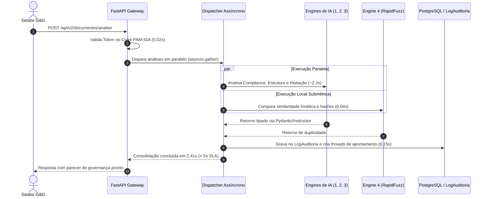

# Diagrama C4 & Fluxo Arquitetural da Fase 2 (LLM Engines & Governança)
**Autoridade:** `Dai_Vibe_Code`  
**Data:** 16 de Outubro de 2026 | **Versão:** 1.0  

---

## 1. Diagrama de Contêineres (C4 Nível 2)

```mermaid
graph TD
    User([Usuário / Gestor G&G]) -->|Submete documento| API[FastAPI Gateway - Porta 8000]
    
    subgraph "Camada de Autenticação & SoD (Fase 1)"
        API -->|Valida Token & Cadeira| PAM[Cofre PAM-IGA / JWT O(1)]
    end

    subgraph "Pipeline Assíncrono da Fase 2 (Asyncio)"
        API --> Dispatcher[Orquestrador Assíncrono de Engines]
        Dispatcher -->|Conformidade & Alçadas| E1[Engine 1: Compliance Checker]
        Dispatcher -->|Integridade e Anexos| E2[Engine 2: Structure Analyzer]
        Dispatcher -->|Sugestões Cirúrgicas| E3[Engine 3: Redaction Suggester]
        Dispatcher -->|Batimento Fonético & Hash| E4[Engine 4: Duplicity Detector - RapidFuzz]
    end

    subgraph "Cabresto & Validação Estrutural"
        E1 --> Guard[Instructor + Pydantic Validator]
        E2 --> Guard
        E3 --> Guard
        E4 --> Guard
    end

    subgraph "Persistência e Auditoria (Fase 1 + Fase 2)"
        Guard -->|Grava apontamentos| DB[(PostgreSQL + pgvector - HDW)]
        Guard -->|Registra log imutável| Audit[LogAuditoria]
    end

    subgraph "Workflow & Notificações (Semanas 3 e 4)"
        Guard -->|Cria threads de revisão| RACI[Matriz RACI / Comentários]
        RACI -->|Aprovado| Pub[Publicação & Assinatura Digital]
    end
```

---

## 2. Anatomia de Execução & Latência


