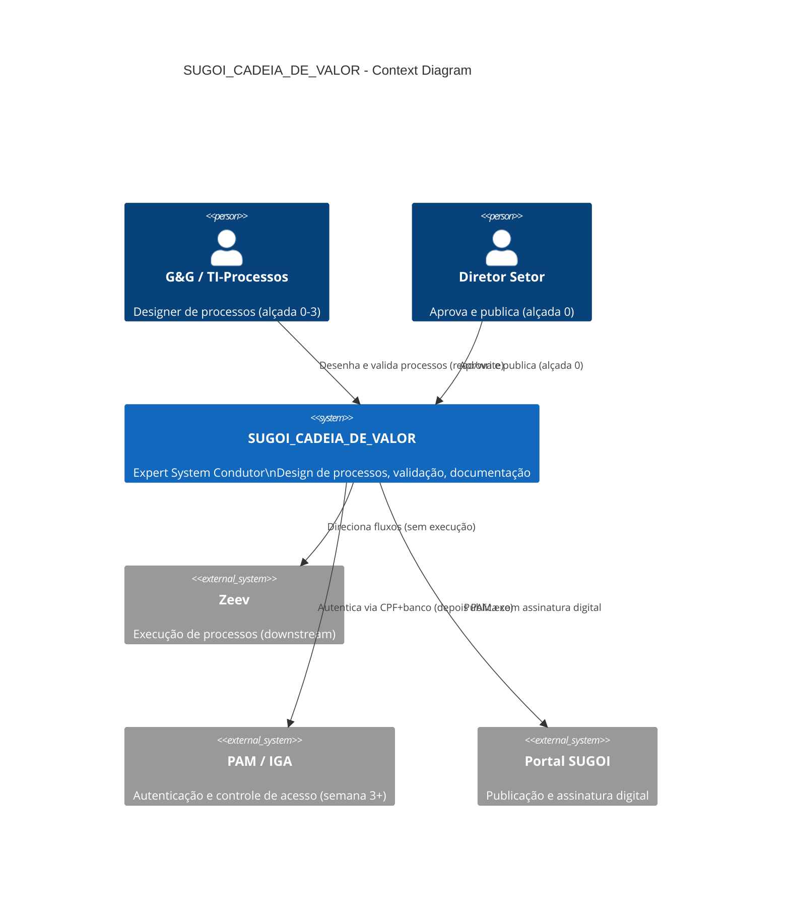
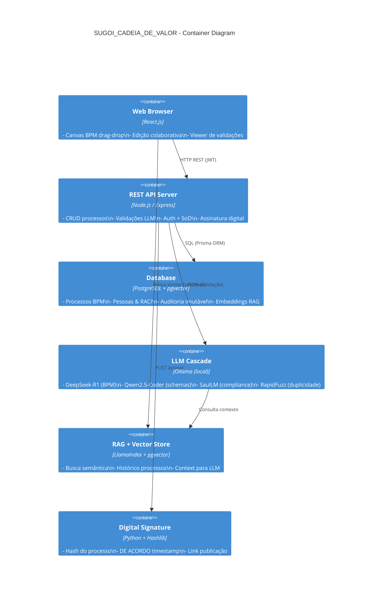
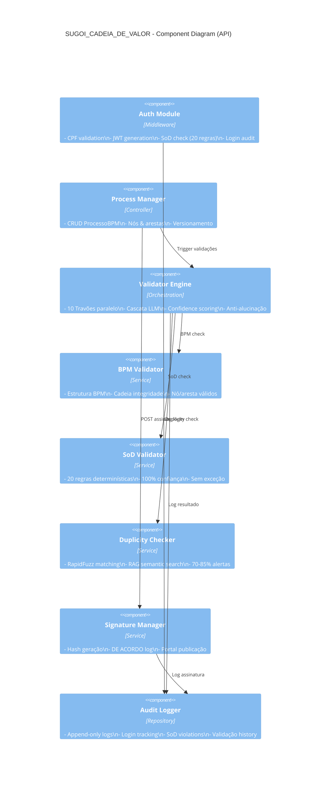
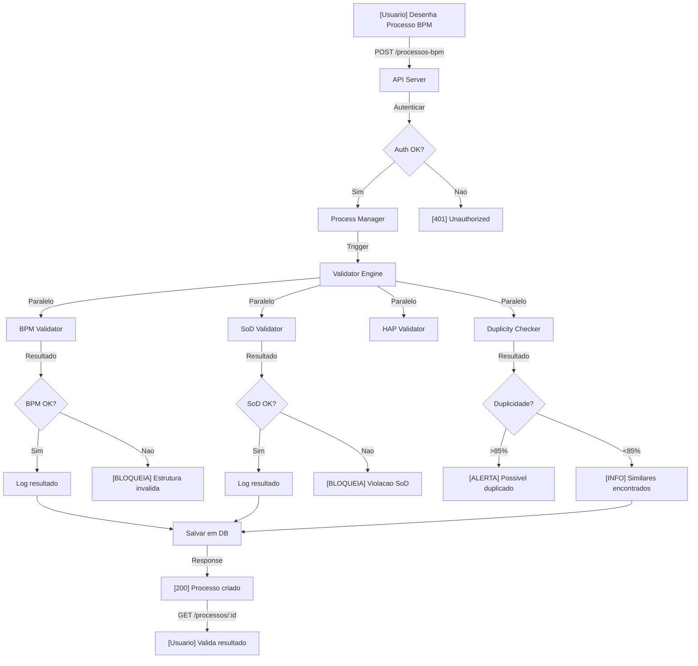
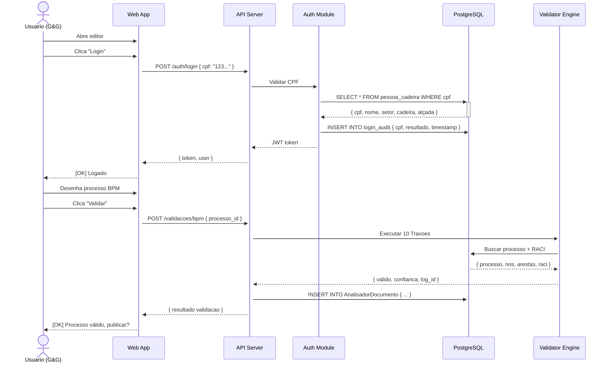

# C4 Architecture Diagrams - SUGOI_CADEIA_DE_VALOR

## Context Diagram



---

## Container Diagram



---

## Component Diagram (API)



---

## Deployment Diagram (FASE 1)

```mermaid
C4Deployment
  title SUGOI_CADEIA_DE_VALOR - Deployment (FASE 1)

  Deployment_Node(dev_machine, "Developer Machine", "Windows 11", "") {
    Container(web, "Web App", "React Dev Server")
    Container(api, "API Server", "Node.js (localhost:3001)")
    Container(db_local, "PostgreSQL", "Docker (localhost:5432)")
    Container(ollama_local, "Ollama", "7 models (localhost:11434)")
  }

  Deployment_Node(git, "GitHub", "Version Control") {
    Container(repo_code, "Code Repository", "Git")
    Container(repo_meta, "Meta_GPT_DAISUGI", "SDD/C4/Schema autogen")
  }

  Rel(api, db_local, "SQL")
  Rel(api, ollama_local, "HTTP (validação)")
  Rel(web, api, "HTTP")
  Rel(repo_code, dev_machine, "git clone/pull")
```

---

## Data Flow Diagram (Validação BPM)



---

## Sequence Diagram (Login + Criação Processo)



---

**Status:** ✅ Completo  
**Formato:** Mermaid diagrams (renderizáveis)  
**Próximo:** Component implementation (FASE 1, Semana 2)

Co-Authored-By: Claude Haiku 4.5 <noreply@anthropic.com>
